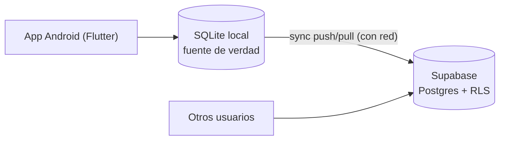

# Seguidor de Precios

Aplicación Android para llevar el control personal de precios de productos de consumo masivo
(almacén, carnicería, verdulería, ferretería, etc.), con **datos locales sin conexión**,
**comparación de precios por artículo** y un **repositorio colaborativo** centralizado en la web.

> **Estado del proyecto:** 🚧 en fase de diseño — todavía no hay código. La Fase 0 arranca con la
> creación del proyecto Flutter. Detalle completo en la [hoja de ruta](docs/hoja-de-ruta.md).

## Características

- 📱 **Android, 100% sin conexión** — los datos viven en el dispositivo (SQLite); ninguna función exige internet.
- 🌱 **Arranca con catálogo** — productos argentinos con código EAN-13 precargados desde bases de datos abiertas (R10).
- 📷 **Escáner de códigos de barras** con la cámara (ML Kit, en el dispositivo) y **ingreso manual** siempre disponible.
- 🥩 **Productos sin código de barras** (carnicería, verdulería, madera, construcción) con unidad de medida y contenido neto.
- ⚖️ **Comparador en dos niveles** — si el producto existe por su código, compara ese producto entre comercios; si no, compara por artículo (tipo de producto) con el precio por unidad de medida ($/kg, $/L, $/unidad) entre marcas y presentaciones (R11, R13).
- 📊 **Mínimo y promedio por artículo** — el precio de referencia de un tipo de producto más allá de su marca o presentación (R12).
- 🕘 **Historial de precios** con fecha de toma del dato y variación porcentual entre tomas.
- 🏪 **Comercios** con alta en el momento, sin salir de la pantalla de registro de precio.
- ☁️ **Colaboración bajo tu control** — sincronización con un repositorio central (Supabase): aviso solo por WiFi y cuando hay novedades, siempre preguntando antes; un ping mínimo mantiene activa la base gratuita (R14, R15).
- 💸 **Recursos gratuitos y perdurables** — sin costos recurrentes y con datos siempre exportables.

## Stack

| Componente | Tecnología | Costo |
| --- | --- | --- |
| Aplicación | Flutter (Dart) | $0 |
| Base de datos local | SQLite vía `drift` | $0 |
| Escáner de códigos | ML Kit Barcode (`mobile_scanner`), on-device | $0 |
| Catálogo inicial (semilla) | Open Food Facts / Open Products Facts (ODbL) | $0 |
| Backend colaborativo | Supabase (Postgres + Auth + RLS), plan gratuito | $0 |
| Distribución | APK vía GitHub Releases | $0 |
| Código e integración continua | GitHub + GitHub Actions | $0 |

## Escala y despliegue a futuro

Pensado para arrancar en un **grupo reducido** con costo $0. Si el proyecto tiene aceptación y se
libera al público, el mismo stack migra a **infraestructura propia** (Supabase self-hosted o
Postgres + PostgREST) sin reescribir la app: todo es open source y los datos son Postgres estándar.
Detalle en [Arquitectura · Escala](docs/arquitectura.md#escala-y-camino-a-infraestructura-propia-r16)
y [Fase 4](docs/hoja-de-ruta.md#fase-4--público-e-infraestructura-propia-condicional-r16).

## Arquitectura en una línea

**Local-first:** la app funciona siempre sin internet; la nube es una capa de colaboración que
sincroniza cuando hay red. Si el backend deja de estar disponible, no se pierde nada.



## Ejemplo: comparador por artículo

Artículo **Mayonesa** (unidad base: kilogramo):

| Producto | Precio | Contenido | Precio por kg |
| --- | --- | --- | --- |
| Marca A · 1 kg | $ 2.700 | 1 kg | **$ 2.700** ⭐ mínimo |
| Marca A · 500 g | $ 1.500 | 500 g | $ 3.000 |
| Marca B · 250 g | $ 900 | 250 g | $ 3.600 |

Promedio del artículo: **$ 3.100/kg**. Así se compara cualquier tipo de producto más allá de la
marca o la presentación: aceite por litro, arroz por kilo, tornillos por unidad, madera por metro.

## Estructura del repositorio

```text
seguidor-precios/
├── README.md                ← este archivo
├── docs/
│   ├── requisitos.md        ← qué debe hacer la app (R1–R12) con criterios de aceptación
│   ├── arquitectura.md      ← principio local-first, componentes, semilla y sincronización
│   ├── modelo-de-datos.md   ← tablas, campos, normalización y agregados
│   ├── decisiones.md        ← decisiones de diseño y su justificación (ADR)
│   ├── hoja-de-ruta.md      ← fases, tareas y riesgos
│   ├── desarrollo.md        ← preparación del entorno y convenciones
│   └── uso.md               ← manual de usuario (flujos previstos)
├── tools/                   ← (Fase 1) script generador del pack semilla
└── app/                     ← (Fase 0) código Flutter
```

## Documentación

| Documento | Contenido |
| --- | --- |
| [Requisitos](docs/requisitos.md) | R1–R12: qué debe hacer la app y cómo se acepta cada requisito |
| [Uso](docs/uso.md) | Manual del usuario: pantallas y flujos previstos |
| [Arquitectura](docs/arquitectura.md) | Local-first, componentes, semilla, sincronización y seguridad |
| [Modelo de datos](docs/modelo-de-datos.md) | Tablas, relaciones, normalización de unidades y agregados |
| [Decisiones](docs/decisiones.md) | Por qué Flutter, Supabase, Open Food Facts, etc. (ADRs) |
| [Hoja de ruta](docs/hoja-de-ruta.md) | Fases 0–3 con tareas, criterios de salida y riesgos |
| [Desarrollo](docs/desarrollo.md) | Entorno, comandos y convenciones del proyecto |

## Licencia

Por definir (ver [decisiones abiertas](docs/decisiones.md#decisiones-abiertas)). El catálogo
semilla proviene de Open Food Facts bajo licencia ODbL y exige atribución: ver
[Arquitectura · Datos semilla](docs/arquitectura.md#datos-semilla-y-enriquecimiento-r10).
