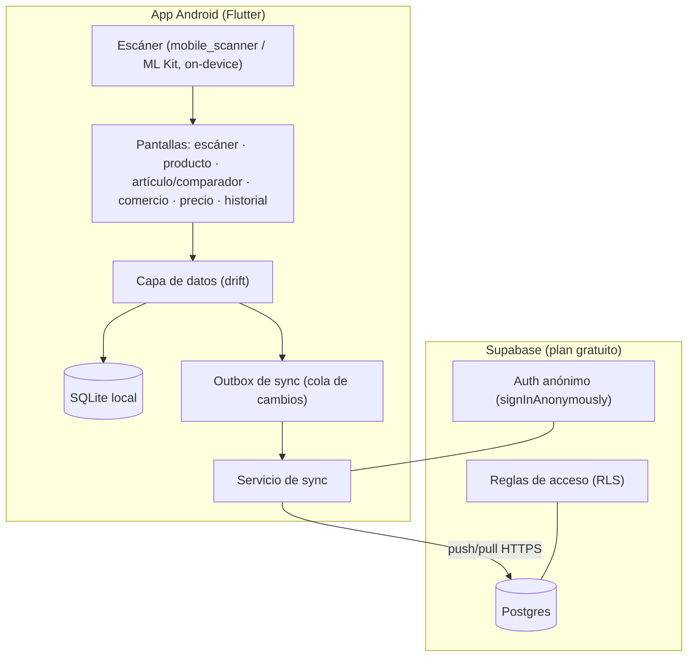
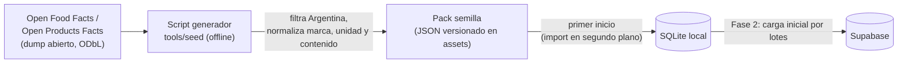
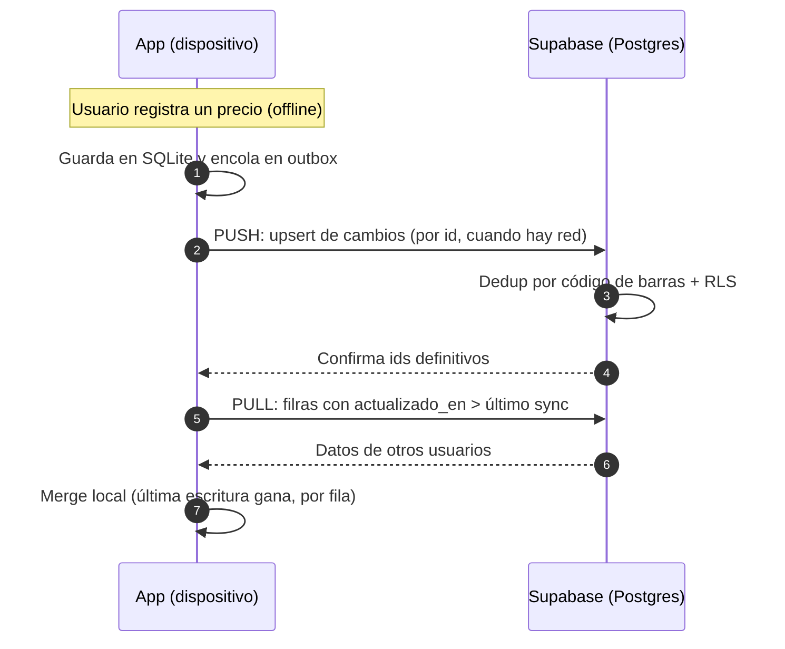
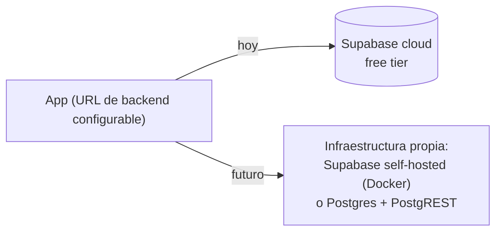

# Arquitectura

## Principio rector: local-first

La **fuente de verdad es la base SQLite del dispositivo**. La app funciona 100% sin conexión:
escanear, dar de alta productos, artículos y comercios, registrar precios, comparar y consultar el
historial nunca dependen de la red. La nube (Supabase) es una **capa de colaboración**: acumula
aportes de todos los usuarios y los distribuye cuando hay conexión.

Si el backend deja de estar disponible (pausa del plan gratuito, caída, migración), la app sigue
funcionando intacta y los datos locales no se pierden.

## Componentes

### Decisiones por componente

| Componente | Elección | Motivo |
| --- | --- | --- |
| UI y lógica | Flutter | Un solo código Android, iOS posible a futuro ([AD-001](decisiones.md#ad-001--flutter-como-framework-de-la-app)) |
| BD local | SQLite + `drift` | SQL tipado, migraciones, formato eterno y exportable ([AD-004](decisiones.md#ad-004--sqlite-vía-drift-como-base-local)) |
| Escáner | ML Kit on-device | Funciona offline, sin costo, sin servidores ([AD-005](decisiones.md#ad-005--escáner-ml-kit-on-device)) |
| Semilla de catálogo | Open Food Facts / Open Products Facts (ODbL) | Catálogo argentino con EAN-13, gratuito y durable ([AD-008](decisiones.md#ad-008--catálogo-semilla-desde-open-food-facts--open-products-facts)) |
| Backend | Supabase (Postgres) | Colaboración con datos exportables y reglas de acceso ([AD-002](decisiones.md#ad-002--supabase-como-backend-colaborativo)) |
| Identidad | Auth anónimo + ID de dispositivo | Cero fricción, sin registro ([AD-003](decisiones.md#ad-003--identidad-anónima--id-de-dispositivo)) |

## Datos semilla y enriquecimiento (R10)

Para que la app no inicie vacía, el catálogo base se genera **offline** desde bases de datos
abiertas y viaja dentro del APK:

- **Generación:** `tools/seed` descarga el dump público, filtra `countries_tags = argentina`,
  normaliza nombre, marca y cantidad ("500 g" → contenido neto + unidad) y emite un pack JSON versionado.
- **Import en primer inicio:** el pack se importa al SQLite local marcando el origen (`semilla`);
  corre en segundo plano y no bloquea el uso de la app.
- **Enriquecimiento (Fase 2):** al escanear un EAN desconocido con conexión, la app consulta la
  API abierta para precargar nombre/marca/contenido antes del alta manual (siempre confirmada por el usuario).
- **Licencia:** los datos provienen de Open Food Facts bajo ODbL; la app muestra la atribución en
  "Acerca de" y el catálogo derivado mantiene compatibilidad de licencia (share-alike).

## Flujo de sincronización

### Reglas de sincronización

1. **Identificadores:** UUID generados en el dispositivo → no hay colisiones entre usuarios y el merge es trivial.
2. **Outbox:** todo cambio local (artículos, productos, comercios, precios) se encola; el push sube por lotes cuando hay red (automático o manual).
3. **Pull incremental:** cada tabla se consulta por `actualizado_en > ultimo_sync`; se guarda un marcador por tabla.
4. **Conflictos:** *última escritura gana* por fila, con la marca de tiempo del servidor como árbitro. Los precios son append-only: nunca hay conflicto de precio.
5. **Borrado:** lógico (`borrado_en`), nunca físico, para que el borrado se propague a otros dispositivos.
6. **Dedup por EAN:** si subo un producto cuyo código de barras ya existe en el servidor, el backend devuelve el id existente y el dispositivo re-apunta sus precios a ese producto (transacción local).
7. **Agrupación por artículo:** los `articulo_id` se sincronizan como cualquier campo; si dos usuarios clasifican el mismo producto en artículos distintos, gana la escritura más reciente y el resto puede reasignarse desde la UI.
8. **Estado local de sync:** la cola outbox y la marca `ultimo_sync` (por tabla) viven solo en el dispositivo; alimentan la condición del aviso de sincronización (R15).

### Política de sincronización al iniciar (R15)

La sincronización **nunca** es automática: la app pregunta. El aviso al iniciar aparece solo si se
cumplen **todas** estas condiciones:

1. Conexión **WiFi** (con datos móviles no aparece; la sync manual sigue disponible con cualquier conexión).
2. Hay **cambios locales sin sincronizar** (outbox no vacío) **o** pasaron **más de 7 días** desde el
   último sync exitoso.

El ping anti-pausa (R14) es otra cosa: es una consulta mínima que no sincroniza nada y corre con
cualquier conectividad.

## Seguridad y acceso

- **RLS en todas las tablas:** cualquiera puede **leer** e **insertar** (ese es el fin colaborativo); **editar nombre/categoría** solo quien lo creó; **borrar** (lógico) solo quien lo creó. Precios: solo insert.
- **Auth anónimo de Supabase:** cada instalación obtiene un usuario estable sin datos personales (`signInAnonymously`); a futuro puede convertirse en cuenta real sin migrar datos.
- **Claves:** la clave anónima de Supabase va embebida en la app (está diseñada para eso; la protección real es la RLS).

## Durabilidad del backend gratuito (R14)

Supabase pausa proyectos gratuitos tras ~7 días sin actividad. Mitigación principal:

- **Ping mínimo desde la app (R14):** al iniciar y solo con conectividad, la app envía una consulta
  mínima (RPC `ping`, un `SELECT 1`) que resetea el contador de inactividad. No sincroniza datos.

Mitigaciones complementarias:

- Cron gratuito de GitHub Actions (útil si nadie abre la app por mucho tiempo), o
- reactivación manual desde el panel (1 minuto, sin costo).

En cualquier caso, R3 nunca se compromete: la app no depende de la nube.

## Escala y camino a infraestructura propia (R16)

El proyecto arranca para un **grupo reducido** con el free tier de Supabase ($0). Si gana aceptación
y se libera al público, el mismo stack migra a infraestructura propia **sin reescribir la app**:

- **Sin lock-in:** Supabase es open source (self-hosteable con Docker) y su capa de API es
  PostgREST; los datos son Postgres estándar y las migraciones SQL del repo son el esquema canónico.
- **Migración:** dump/restauración de la base (`pg_dump`/`restore`); la app apunta al nuevo backend
  cambiando URL + clave en su único punto de configuración.
- **Qué exige la escala pública:** política de moderación y anti-abuso (rate limiting, revisión de
  RLS), backups automáticos, monitoreo y decisión de distribución (APK vs Play Store).
- Todo está planificado como [Fase 4](hoja-de-ruta.md#fase-4--público-e-infraestructura-propia-condicional-r16),
  **condicional**: solo se ejecuta si hay adopción real.
