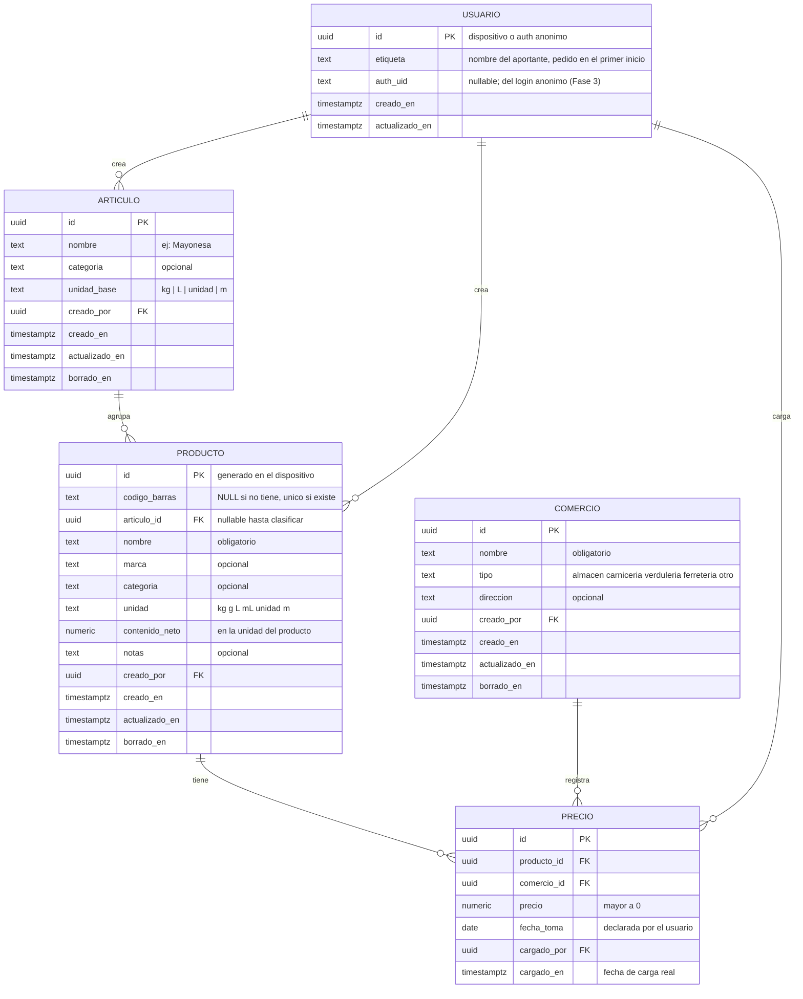

# Modelo de datos

El mismo esquema vive en dos lugares: **SQLite local** (fuente de verdad del dispositivo, vía `drift`)
y **Postgres en Supabase** (repositorio colaborativo). La sincronización copia filas entre ambos
usando los mismos ids (ver [flujo de sincronización](arquitectura.md#flujo-de-sincronización)).

Concepto clave (R11/R12): el **artículo** (tipo de producto genérico, p. ej. "Mayonesa") agrupa
**productos** (marca + presentación concreta, p. ej. "Mayonesa Marca A 500 g"). La comparación de
precios ocurre entre productos de un mismo artículo, normalizada por unidad de medida.

## Vista general



## Tablas

### articulo (nuevo — R11/R12)

| Campo | Tipo | Regla |
| --- | --- | --- |
| `id` | UUID | PK |
| `nombre` | TEXT | obligatorio; el tipo de producto ("Mayonesa", "Aceite de girasol") |
| `categoria` | TEXT | opcional (almacén, bebidas, limpieza, etc.) |
| `unidad_base` | TEXT | `kg`, `L`, `unidad`, `m`; define la unidad en la que se compara el artículo |
| `creado_por` | UUID | FK → usuario |
| `creado_en` / `actualizado_en` / `borrado_en` | TIMESTAMP | columnas de sync |

### producto

| Campo | Tipo | Regla |
| --- | --- | --- |
| `id` | UUID | PK, generado en el dispositivo |
| `codigo_barras` | TEXT | **NULL** si el producto no tiene (R7); **único parcial** si existe (dedup R4) |
| `articulo_id` | UUID | FK → articulo, **nullable** hasta clasificar (R11) |
| `nombre` | TEXT | obligatorio |
| `marca` | TEXT | opcional ("Hellmann's", "Marca B") |
| `categoria` | TEXT | opcional |
| `unidad` | TEXT | `kg`, `g`, `L`, `mL`, `unidad`, `m` — la unidad en que se vende (R7, R12) |
| `contenido_neto` | NUMERIC | nullable; cantidad de producto en `unidad` (ej. 500 g → `500`, unidad `g`); granel: implícito = 1 (AD-014) |
| `notas` | TEXT | opcional |
| `creado_por` | UUID | FK → usuario |
| `creado_en` / `actualizado_en` / `borrado_en` | TIMESTAMP | columnas de sync; `borrado_en` = soft delete |

### comercio

| Campo | Tipo | Regla |
| --- | --- | --- |
| `id` | UUID | PK |
| `nombre` | TEXT | obligatorio |
| `tipo` | TEXT | `almacen`, `carniceria`, `verduleria`, `ferreteria`, `otro` |
| `direccion` | TEXT | opcional |
| resto | — | igual que producto (`creado_por`, columnas de sync) |

### precio (append-only)

| Campo | Tipo | Regla |
| --- | --- | --- |
| `id` | UUID | PK |
| `producto_id` | UUID | FK → producto |
| `comercio_id` | UUID | FK → comercio |
| `precio` | NUMERIC(12,2) | obligatorio, mayor a 0 |
| `fecha_toma` | DATE | fecha declarada por el usuario (R8); hoy por defecto, editable |
| `cargado_por` | UUID | FK → usuario |
| `cargado_en` | TIMESTAMP | fecha de carga; el servidor la normaliza al recibir el push y es el **cursor de pull** de la tabla; nunca se actualiza ni borra |

### usuario

Representa una instalación de la app (id de dispositivo) o, a futuro, una cuenta real vinculada
(diferida, Fase 3). En la etapa de pruebas lleva la **etiqueta del aportante**, que se pide en el
primer inicio y viaja con cada dato cargado (R17/R18). La etiqueta se **sincroniza** para que el
grupo vea quién aportó; `auth_uid` (nullable) se completa en el primer login anónimo y resuelve la
identidad de los datos creados offline (regla de sync 9).

### valoracion (v2 — v0.1.5)

| Campo | Tipo | Regla |
| --- | --- | --- |
| `id` | UUID | PK |
| `usuario_id` | UUID | FK → usuario; la valoración es **personal** |
| `producto_id` | UUID | FK → producto |
| `gusto` | TEXT | `si` / `no` / **NULL** (neutro por defecto: sin fila cargada) |
| `observacion` | TEXT | opcional; nota personal breve (ej.: "salió bueno, para repetir") |
| `creado_en` / `actualizado_en` | TIMESTAMP | columnas de sync |

- Una fila por (usuario, producto): volver a neutro sin observación **elimina la fila** (quedan cero datos).
- Esquema local v2 (v0.1.5): migración agrega la tabla sin tocar las existentes.
- Viaja en el backup JSON (incluida desde v0.1.5; los backups anteriores siguen importables).
- Fase 2 (colaborativa): la tabla **se sincroniza**; la ponderación con las valoraciones de otros
  aportantes (sin perder la propia) queda **postergada a una fase posterior** — decisión del
  dueño: por ahora solo se sincronizan.

## Precio por unidad de medida (normalización) — R11

Para comparar presentaciones distintas, cada precio se normaliza a la unidad base del artículo:

```text
precio_unitario = precio / (contenido_neto × factor(unidad → unidad_base))
```

| Unidad del producto | Unidad base | Factor |
| --- | --- | --- |
| `g` | `kg` | ÷ 1000 |
| `kg` | `kg` | × 1 |
| `mL` | `L` | ÷ 1000 |
| `L` | `L` | × 1 |
| `unidad` | `unidad` | × 1 |
| `m` | `m` | × 1 |

Ejemplo — artículo **Mayonesa** (`unidad_base = kg`):

| Producto | Precio | Contenido | Cálculo | Precio por kg |
| --- | --- | --- | --- | --- |
| Marca A · 1 kg | $ 2.700 | 1 kg | 2700 / 1 | **$ 2.700** ⭐ |
| Marca A · 500 g | $ 1.500 | 500 g | 1500 / 0,5 | $ 3.000 |
| Marca B · 250 g | $ 900 | 250 g | 900 / 0,25 | $ 3.600 |

Se calcula **en consulta, no se almacena**: siempre refleja el precio y la presentación vigentes.

### Jerarquía de comparación (R13)

1. **Producto exacto (mismo EAN):** si el producto con ese código ya existe, la comparación más
   valiosa es la de ese producto entre comercios (misma referencia, comparación perfecta).
2. **Artículo (tipo de producto):** si no hay coincidencia por código, o el producto no tiene código,
   la comparación es solo por artículo, normalizada por unidad de medida (R11).

## Agregados por artículo (mínimo y promedio) — R12

Vista `resumen_articulo` (SQL local; en Postgres, vista o materializada en Fase 2):

| Campo | Significado |
| --- | --- |
| `articulo_id` | artículo |
| `unidad_base` | kg / L / unidad / m |
| `precio_min` | mínimo del precio por unidad entre sus productos |
| `precio_prom` | promedio del precio por unidad |
| `precio_max` | máximo del precio por unidad |
| `muestras` | cantidad de precios considerados |

- Ventana por defecto: **últimos 30 días** de `fecha_toma`, con opción "todo el histórico".
- Calculado sobre el **último precio conocido por producto+comercio** dentro de la ventana (evita sesgo por precios repetidos).
- Filtro opcional por comercio.
- Los productos sin `contenido_neto` o sin `articulo_id` no participan del agregado (R12).
- **Granel (AD-014):** los bienes vendidos por kg/L/m/unidad sin contenido neto fijo (asado, verdulería, madera) se tratan con **contenido neto = 1 implícito**: su precio por unidad es el precio tal cual.
- **Ventana vacía:** si ningún precio del artículo entra en la ventana, el comparador muestra el estado vacío con acceso directo a "todo el histórico" (no desaparece silenciosamente).

## Reglas de integridad

1. **Precios append-only:** ni el usuario ni la sync modifican el **valor, el comercio ni la fecha** de un precio; el historial (R8) es inmutable. Única excepción: el re-apunte de `producto_id` durante la dedup por EAN (ajusta el puntero, no el dato).
2. **Código de barras único:** índice único parcial sobre `producto.codigo_barras WHERE codigo_barras IS NOT NULL`. Es la base de la dedup colaborativa.
3. **Comparabilidad normalizada (R11):** el precio por unidad solo se calcula si el producto tiene `contenido_neto` (o es a granel: implícito = 1, AD-014) y su `unidad` puede normalizarse a la `unidad_base` de su artículo; sin eso, el producto va al historial pero no al comparador.
4. **Asignación de artículo (R11):** `producto.articulo_id` puede quedar NULL hasta clasificar; la asignación es manual o sugerida por categoría/nombre (coincidencia difusa en Fase 3).
5. **Borrado lógico:** productos, artículos y comercios no se borran físicamente; se marca `borrado_en`, desaparecen de las listas y conservan su historial.
6. **Columnas de sync:** todas las tablas sincronizadas llevan `creado_en`, `actualizado_en` y `borrado_en`, **excepto `precio`** (append-only: solo `cargado_en`, su cursor de pull).

## Índices principales

| Tabla | Índice | Para |
| --- | --- | --- |
| producto | único parcial `(codigo_barras)` | dedup por EAN |
| producto | `(articulo_id)` | comparador y agregados por artículo (R11/R12) |
| producto | `(nombre)`, `(marca)` | búsqueda por nombre y marca |
| precio | `(producto_id, fecha_toma DESC)` | historial (R8) |
| precio | `(fecha_toma)` | agregados por ventana de tiempo (R12) |
| comercio | `(nombre)` | selección rápida |

## Esquema backend (Postgres)

El backend colaborativo (Fase 2) espeja el esquema local en **6 tablas** — `usuario`, `articulo`,
`producto`, `comercio`, `precio` y `valoracion` — con los mismos nombres de columna en snake_case
que el esquema local (`app/lib/data/local/tablas.dart`) y tipos nativos de Postgres (`uuid`,
`timestamptz`, `numeric`, `date`); la conversión con el texto ISO-8601 local la hace la capa de
sync. El DDL canónico vive en el repo (no se duplica acá): `supabase/migrations/0001_esquema_colaborativo.sql`,
`supabase/migrations/0002_permisos_service_role.sql` y `supabase/migracion-completa.sql`
(mismo DDL concatenado, archivo único para pegar en Supabase Studio).

| Pieza | Detalle |
| --- | --- |
| Tablas (6) | Espejo 1:1 del esquema local: mismas columnas, `CHECK` de dominio (unidades, tipo de comercio, gusto `si`/`no`, `precio > 0`), FKs y `borrado_en` como borrado lógico; `usuario` con `auth_uid` único (mapeo 1:1 con la sesión anónima) |
| Índices | Único parcial `(codigo_barras)` solo sobre filas vigentes (`WHERE codigo_barras IS NOT NULL AND borrado_en IS NULL`), base del dedup por EAN; índices de búsqueda, comparador y cursores de pull (`precio.cargado_en`) |
| Triggers | `actualizado_en` lo estampa el servidor en todo insert/update (árbitro de la última-escritura-gana y cursor de pull, reglas de sync 3-4); `precio` append-only: rechaza todo `UPDATE` salvo el re-apunte de `producto_id`, y su `cargado_en` lo normaliza el servidor; guardia de borrado lógico: solo el creador de la fila, sesión de servidor (Studio/servicio) o dedup en curso |
| RPC | `ping()` — keep-alive del plan gratuito (R14), no sincroniza datos; `dedup_ean(codigo_barras)` — regla de sync 6: devuelve el producto canónico del EAN, re-apunta sus precios y da de baja lógica los duplicados (`SECURITY DEFINER`, idempotente) |
| RLS (AD-016) | Solo sesiones `authenticated` (login anónimo): leen todo, insertan a su propio nombre, corrigen columnas de clasificación de cualquiera y borran (lógico) solo lo suyo; `precio` sin `UPDATE` ni `DELETE`; `valoracion` solo filas propias. Moderación mínima: sin rate limiting (diferido a Fase 4) |
| Admin (AD-015) | Políticas `admin_dueno` con `es_admin()`: `auth_uid` fijo del dueño (placeholder `<<UID_DUENO>>` a reemplazar antes de aplicar; mientras tanto evalúa falso: operación segura por defecto) |
| Correctivo 0002 | `GRANT` a `service_role` (tablas, `EXECUTE` de funciones, secuencias): sin él el cargador del semillero recibía `permission denied for table`; RLS sigue filtrando, esto solo habilita el acceso a nivel de tabla |

Sin `FORCE ROW LEVEL SECURITY`: el dueño (rol de Studio) corrige cualquier fila sin límites (R18,
AD-013). Procedimiento de puesta en marcha: [Desarrollo · Backend colaborativo](desarrollo.md#backend-colaborativo-fase-2).
